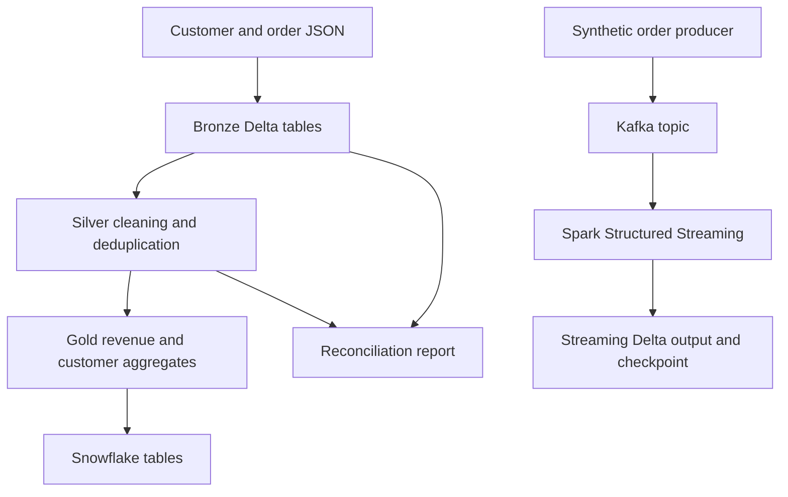

# Pipeline architecture

Batch ingestion produces Gold analytics tables and Snowflake exports. Streaming ingestion currently writes to its own Delta destination; it is not automatically merged into the batch Gold tables.

## Execution boundaries

| Component | Runs in | Configuration |
| --- | --- | --- |
| Batch transformations | Databricks | `base_path` widgets and source JSON in a Unity Catalog Volume |
| Gold export | Databricks with Snowflake Spark connector | Snowflake environment variables and destination permissions |
| Order producer | Local Python environment | Repository-root `.env` with Kafka connection details |
| Kafka consumer | Databricks | Kafka widgets and explicitly configured Delta/checkpoint paths |

The consumer processes available events with `availableNow=True` and terminates. A checkpoint retains streaming progress between executions. This configuration does not by itself establish end-to-end exactly-once delivery.

## Validation and limits

- Quality notebooks report invalid fields and duplicate orders. Review the reports; they are not CI-enforced gates.
- Reconciliation compares record counts across layers and reports rejected and duplicate records.
- Notebook paths are configured in notebook widgets or code. The YAML file is a configuration reference, not a universal runtime configuration loader.
- Some notebooks remove existing demo output paths or overwrite tables. Run against dedicated demo resources.
- The small committed CSV exports illustrate the output schema. They do not establish large-scale throughput or production reliability.

See the [main README](../README.md) for the run sequence and the [notebooks](../notebooks) for the implementation.
